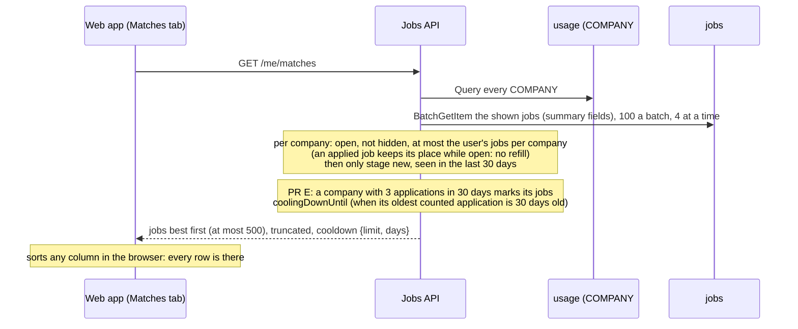

# Flow: Matches, applying by hand, and Applications (#52)

A job lives in one `jobs` item, and its **stage** (`status`) says which tab shows it: `new` in **Matches**; `applied`, `interviewing`, `offer`, `rejected` or `withdrawn` in **Applications**. Moving a job changes that one item; nothing is copied. Decision: [0016](../decisions/0016-applications-are-job-stages.md). Before this: [relevance flow](relevance.md) (which jobs a company shows).

- **Task:** [#52](https://github.com/jobdeputy/jobdeputy/issues/52). Matches and applying by hand: PR C. The Applications tab: PR D. The cooldown (3 applications per company in a rolling 30 days, [0013](../decisions/0013-apply-flow-rules.md)): PR E.
- **Keep it true:** a PR that changes this flow updates this file, like [data-model.md](../data-model.md).

## Matches



## Auto apply (#54 PR D3)

The job's pane hands the job to the browser extension ([extension flow](extension.md#auto-apply-and-recording-the-application-54-pr-d)); the person still submits on the employer's form.

```mermaid
sequenceDiagram
  actor User
  participant Web as Web app (job pane)
  participant X as Extension (service worker)
  participant API as Jobs API
  Web->>X: hello (chrome.runtime.sendMessage, each ID in /config.json extensionIds)
  X-->>Web: version, signed in (none answers: missing; no IDs: Soon)
  Web->>API: GET /me/jobs/{jobId} (a Greenhouse job: its externalId)
  User->>Web: Auto apply
  Web->>X: auto-apply {jobId, url: job-boards.greenhouse.io/<board>/jobs/<externalId>}
  X-->>Web: ok (it opened and fills the form) / signed-out / not-greenhouse / wrong-job / failed
  Web->>User: ok: "Did you apply on the employer site?" (as Manual apply); else why, said below
  Note over Web: back on the page (focus): GET /me/matches again;<br/>a job the extension recorded has left it, and the pane closes, saying so
```

- Auto apply is unavailable, saying why, for a job not on Greenhouse, while its company cools down, and without the extension (then it says to add it). Signed out of the extension, it can still be pressed: the extension tries a sign-in without a window first.
- The form's address is built from the job's board and posting ID (`greenhouseFormUrl`), never `jobUrl`, which is often the company's careers page.

## Applying by hand, and moving a stage

```mermaid
sequenceDiagram
  actor User
  participant Emp as Employer's site (new tab)
  participant Web as Web app
  participant API as Jobs API
  participant J as jobs
  participant U as usage (APPLIED#)
  participant A as audit
  User->>Web: a Matches row → the job's pane → Manual apply
  Web->>Emp: open applyUrl (else jobUrl) in a new tab
  User->>Emp: applies there, and clicks Submit
  Web->>User: "Did you apply on the employer site?" (I applied / Not yet)
  User->>Web: I applied
  Web->>API: PUT /me/jobs/{jobId}/stage {stage: applied, from: new}
  API->>J: GetItem (consistent)
  API->>U: GetItem APPLIED#<companyKey> (consistent; applying, or undoing an apply not yet moved on)
  alt gone / not at "from"
    API-->>Web: 404 / 409 stage-changed (with the job as it is now)
  else 3 applications to the company in the last 30 days (PR E)
    API-->>Web: 409 cooling-down, until (with the job)
  else
    API->>J: TransactWriteItems: SET status, stageAt, appliedAt, appliedResumeId, REMOVE ttl<br/>if status = from
    API->>A: (same transaction) PutItem job.stage_changed
    API->>U: (same transaction) PutItem APPLIED# + this job, if still at the version read<br/>(changed meanwhile: read both again, at most 3 tries, then 409 try-again)
    API-->>Web: 200 the job
  end
  Note over J: appliedAt puts the job in the sparse "applied" index
  Note over Web: 200: out of the table at once, the pane closes, "Marked as applied" with Undo<br/>(PUT {stage: new, from: applied}); then GET /me/matches again.<br/>An error: said in the question, and Matches read again (a job gone from it closes the pane, saying why)
```

From `new` the only move is to `applied` (nothing else has an applied date). The browser extension (#54 PR D, decision 0020) may make that one move, and no other (403 `extension-stage`): its tokens carry no `WEB_SCOPE`. Later stages change `status` and `stageAt` only; `appliedAt` stays. Back to `new` (an apply undone, only from `applied`) removes `appliedAt` and `appliedResumeId`, which takes the job out of the index; a closed or hidden job then expires again (`ttl`), as one never acted on, and takes the job out of its company's `APPLIED#` item (freeing its place in the cooldown) if its stage never moved past applied. The undo is conditioned on the closed and hidden state it read, so a crawl changing either meanwhile makes it a 409 rather than a wrong expiry. A crawl closing a job sets its expiry only if it is still `new` at that moment (the user may apply between the crawl's two writes).

## The company cooldown (PR E)

Applying (`new` → `applied`) to a company the user applied to 3 times in the last 30 days is refused (409 `cooling-down`, with `until`); Matches marks that company's jobs `coolingDownUntil` (a job's own entry never counts against applying to it again, in Matches as in the stage change). Every application counts for 30 days from `appliedAt`, whatever its later stage (withdrawn and rejected too: the company saw it); an apply undone straight away (a "Yes" by mistake) does not count, but one undone after a later stage (set back to applied, then undone) still does; applying to that job again keeps the earlier entry, so undoing the new apply never erases it. The count lives in one `usage` item per company, `APPLIED#<companyKey>`, replaced whole in the stage change's own transaction only at the version read, so two applies at once (two tabs) can never both take the last place: the second reads again and is refused. Applications are kept for 365 days (the longest window an admin can set, so raising the window counts the ones already made), and the item expires (`ttl`) a year after its newest one; one left empty expires at once. In the app (PR E2), the Company column says `Cooling down until <date and time>`, and the job's pane has Manual apply unavailable, saying why and until when; an I applied refused this way (Matches out of date) says so, and Matches read again turns Manual apply off. The app treats a job as cooling down only while `coolingDownUntil` is ahead (by the browser's clock), and draws Matches again when the soonest one ends, so applying opens on time without reading Matches again. The limit and the window are the admin's `applyCompanyLimit` and `applyCooldownDays` ([runbook](../runbooks/crawl-limits.md)). Applications made before PR E have no entry, so they do not count (there were none in prod).

## Applications

```mermaid
sequenceDiagram
  participant Web as Web app (Applications tab)
  participant API as Jobs API
  participant I as jobs, index "applied"
  participant J as jobs
  Web->>API: GET /me/applications?cursor=…
  API->>I: Query userId, newest appliedAt first, 50, keys only (eventually consistent)
  API->>J: BatchGetItem the page's jobs (consistent, summary fields); drop any back at new
  API-->>Web: jobs, nextCursor
  Note over Web: the table in the server's order (More applications reads the next page)
  Web->>API: PUT /me/jobs/{jobId}/stage {stage: interviewing, from: applied}
  alt changed meanwhile (another tab or device)
    API-->>Web: 404 / 409 stage-changed
    Note over Web: said in an alert; GET /me/applications again (the job as it is now, or gone)
  else saved
    API-->>Web: 200, the job
    Note over Web: the row shows the stage saved, kept in its place (the order is by appliedAt);<br/>a row read later shows its own stage only if its stageAt is as new or newer
  end
```

In Applications a stage moves between `applied`, `interviewing`, `offer`, `rejected` and `withdrawn` in any direction (a stage set by mistake can be put back). Back to `new` is only Matches' Undo.

## Where the data is

| What | Where |
|---|---|
| The stage, when applied, the résumé used | `jobs` item: `status`, `appliedAt`, `stageAt`, `appliedResumeId` |
| Applied jobs, newest first | `jobs` GSI `applied` (`userId`, `appliedAt`), keys only |
| Who changed what | `audit` `job.stage_changed` (`from`, `stage`, `client`: `web` or `extension`, #54 PR D) |
| Applications per company in the last 365 days (PR E) | `usage` `APPLIED#<companyKey>`: `applied` (`jobId` → `appliedAt`), `version`, `ttl` |
