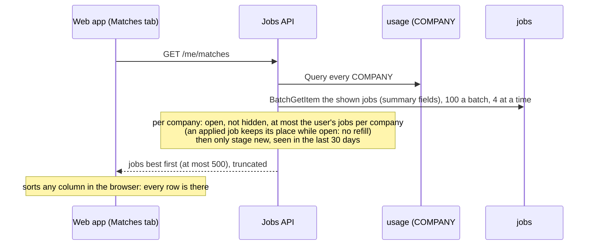
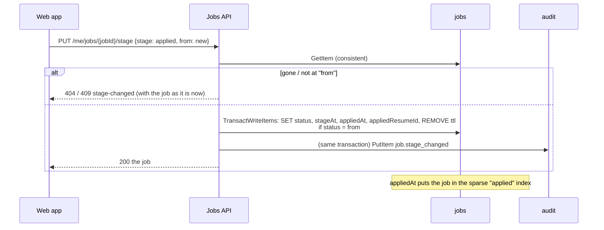
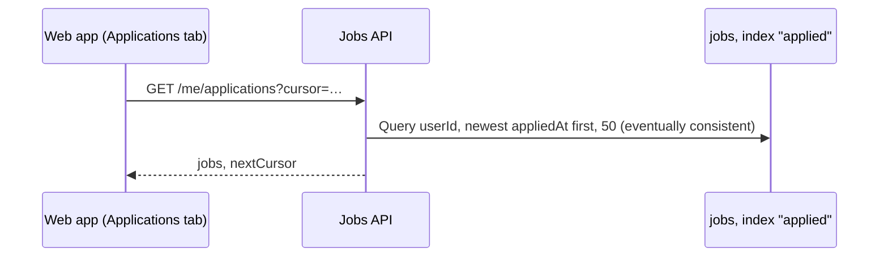

# Flow: Matches, applying by hand, and Applications (#52)

A job lives in one `jobs` item, and its **stage** (`status`) says which tab shows it: `new` in **Matches**; `applied`, `interviewing`, `offer`, `rejected` or `withdrawn` in **Applications**. Moving a job changes that one item; nothing is copied. Decision: [0016](../decisions/0016-applications-are-job-stages.md). Before this: [relevance flow](relevance.md) (which jobs a company shows).

- **Task:** [#52](https://github.com/jobdeputy/jobdeputy/issues/52). The web tabs come in the next PRs of its stack; the cooldown (3 applications per company in 30 days) in PR E.
- **Keep it true:** a PR that changes this flow updates this file, like [data-model.md](../data-model.md).

## Matches

## Applying by hand, and moving a stage

From `new` the only move is to `applied` (nothing else has an applied date). Later stages change `status` and `stageAt` only; `appliedAt` stays. Back to `new` (an apply undone, only from `applied`) removes `appliedAt` and `appliedResumeId`, which takes the job out of the index; a closed or hidden job then expires again (`ttl`), as one never acted on. The undo is conditioned on the closed and hidden state it read, so a crawl changing either meanwhile makes it a 409 rather than a wrong expiry. A crawl closing a job sets its expiry only if it is still `new` at that moment (the user may apply between the crawl's two writes).

## Applications

## Where the data is

| What | Where |
|---|---|
| The stage, when applied, the résumé used | `jobs` item: `status`, `appliedAt`, `stageAt`, `appliedResumeId` |
| Applied jobs, newest first | `jobs` GSI `applied` (`userId`, `appliedAt`), projecting the list fields only |
| Who changed what | `audit` `job.stage_changed` (`from`, `stage`) |
