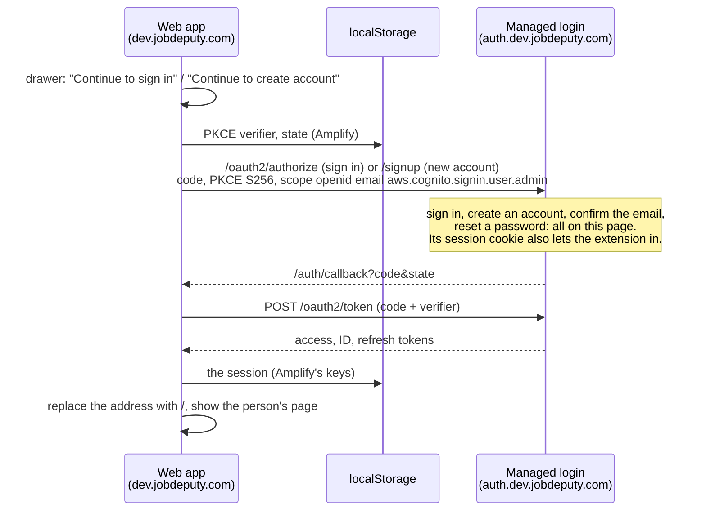

# Flow: signing in to the web app (#111)

The web app signs in through Cognito **managed login** at `auth.<site>` (`auth.dev.jobdeputy.com`), the page the browser extension uses too, so one sign-in serves both: each client still gets its own tokens. Decision: [0021](../decisions/0021-one-sign-in-through-managed-login.md). The extension's side: [extension.md](extension.md).

- **Task:** [#111](https://github.com/jobdeputy/jobdeputy/issues/111). Infra: PR A (#112). The web app: PR B. The extension's silent sign-in: PR C.
- **Keep it true:** a PR that changes this flow updates this file.

## Signing in or creating an account

- `config.json` (from the site's cell) names the pool, the web client and `authDomain`; the site's CSP lets the app call that origin (token, revoke).
- Finishing waits for Amplify's own word that the code exchange is done (its Hub), up to 60 s, then lets the session say: a session read alone waits only 5 minutes after leaving, too short for a new account's email code.
- A sign-in that comes back unfinished (`?error=`, or no sign-in to finish) reopens the drawer as it was left (sign in or create an account, kept in sessionStorage) saying so. Back from the sign-in page brings the landing page back with its button ready.
- Back from the callback is a fresh page load: focus starts at the top, as on any load.
- The person's email comes from the ID token (`email` scope); managed login gives no login ID.

## Signing out

Sign out forgets the tokens (revoking the refresh token), then goes through managed login's `/logout`, which ends its session and comes back to the site's home. The extension keeps its own tokens until it signs out on its own; it can no longer sign in silently until the person signs in again.

## Stored

| What | Where | How long |
|---|---|---|
| Access, ID, refresh tokens | localStorage (Amplify's `CognitoIdentityServiceProvider.*` keys) | until sign-out or a refused refresh (refresh token: 30 days) |
| PKCE verifier and state while away | localStorage (Amplify) | until the callback |
| Managed login's session | a cookie on `auth.<site>` | about an hour |

## Local development

Dev stacks also let a web app on Vite's dev server sign in (`http://localhost:5173`, pinned with `strictPort`; never prod). The dev server serves no `config.json` of its own, so the app there says sign-in isn't available until it is given one; the test build (`--mode e2e`) uses the fake instead (`src/lib/auth/fake.ts`).
