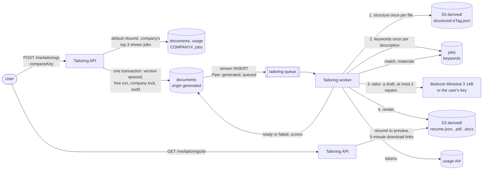

# Flow: a tailored résumé for a company (#51)

One click on **Tailor** for a company makes one version of the user's résumé for that company's top shown jobs (at most 3, and never more than the user's jobs per company), with an ATS match score per job. The model rewrites only the summary, the skills list, and the bullets; code keeps it honest and computes the score. Decision: [0015](../decisions/0015-ats-match-score-and-tailored-resumes.md). Before this: [relevance flow](relevance.md) (which jobs a company shows).

- **Task:** [#51](https://github.com/jobdeputy/jobdeputy/issues/51) (M3 of the apply flow). The screens (PR C) are in the Matches job pane; cover letters (PR D) run the same way, below in [A cover letter for a job](#a-cover-letter-for-a-job-pr-d).
- **Keep it true:** a PR that changes this flow updates this file, like [data-model.md](../data-model.md).

## The big picture



## Asking for a version

```mermaid
sequenceDiagram
  actor U as User
  participant A as Tailoring API
  participant DB as DynamoDB
  U->>A: POST /me/tailorings {companyKey, aiSource?}
  A->>DB: AI setting (preferences), key status (ai-keys)
  Note over A: aiSource none → 422 model_needed
  A->>DB: uploaded documents (Query)
  Note over A: no ready default with text → 422 no_resume
  A->>DB: usage COMPANY#companyKey (shown jobs), jobs (BatchGet)
  Note over A: ranked, open and shown, top 3 (or the user's jobs per company); none → 422 no_jobs
  A->>DB: TransactWrite: version queued + audit + MONTH# tailoringRunIds (platform, < 10) + TAILOR# lock
  alt month full
    A-->>U: 429 tailoring_allowance (retry-after: next month)
  else a run for this company in progress
    A-->>U: 409 tailoring_busy
  else
    A-->>U: 202 {tailoring: queued}
  end
```

## The run, inside the worker

```mermaid
sequenceDiagram
  participant Q as Queue
  participant W as Tailoring worker
  participant DB as DynamoDB
  participant S3
  participant M as Model
  Q->>W: {userId, documentId}
  W->>DB: claim (queued/processing → processing, attempts + 1)
  Note over W: ended → skip · asked over 60 min ago → failed stopped · a kept draft → render it (no model call) · 5 calls used → failed stopped
  W->>DB: base résumé, jobs, key (KMS for an own key), profile
  alt no cached structure for this file (ETag) and prompt
    W->>S3: text.txt
    W->>M: structure-resume (first 10,000 characters)
    W->>DB: store the call (tokens) before anything else
    Note over W: grounded in the text; no entries left → failed resume_unreadable
    W->>S3: structured-<eTag>.json
    W->>DB: documents.structured (only for this ETag)
  end
  alt a job without cached keywords for its description
    W->>M: job-keywords (the missing jobs, one call)
    W->>DB: store the call; jobs.keywords
  end
  loop at most 3 tailoring calls
    W->>M: tailor-resume (draft, then repairs naming what failed)
    W->>DB: store the call
    Note over W: honesty checks and scores in code; stop when nothing is left to fix
  end
  alt no draft came back
    W->>DB: failed model_unavailable
  else only dishonest drafts
    W->>DB: failed no_honest_draft
  else
    W->>DB: the kept draft, its scores and company (tailoring.drafted; once per run)
    W->>S3: resume.json, resume.pdf, resume.docx
    W->>DB: jobs.match, jobs.materials (idempotent, before the end)
    W->>DB: ready (scores, ok or partial) + lock freed + audit
    W->>DB: versions past 10 for the company deleted (and their files)
  end
```

- **Calls:** at most 5 task calls a run (structure 1, keywords 1, tailoring 3), counted on the version (`tailoring.calls`) across retries. Each call is stored with its tokens before the next starts; a duplicate delivery cannot store one twice (the count's condition).
- **Retries:** an error goes back to the queue, which tries again 1, then 2 minutes later (not after its visibility timeout). Finished calls are cached (structure, keywords, the kept draft) or counted, and tailoring ends with its best honest draft rather than throwing after its first call, so a retry never repeats a finished call. The last attempt ends the run `failed` whatever went wrong, so it never stays in progress; a rejected own key fails it at once (`key_rejected`).
- **The free allowance:** 10 platform runs a month, counted when asked; given back when no model call was made (no résumé, no jobs, no key). Own-key runs are not counted.
- A structured copy made for a résumé replaced or deleted meanwhile is deleted (only that file version's copy).
- Another delivery of the same message never ends a run: when it loses the race to store a call, its message is kept for a retry (which then finds the run moved on or ended); a second draft is refused, and that delivery stops.
- The jobs are linked before the version ends (a failure there is retried); once it is ready, pruning old versions is best effort (logged).
- A new structured copy, once recorded, deletes the copy of the earlier upload.

## What a version's state can be

| `status` | Meaning | Shown as |
|---|---|---|
| `queued` | Asked for; the worker has not started | in progress |
| `processing` | The worker is running it (or waiting to try again) | in progress (after 60 minutes: failed, `stopped`) |
| `ready` | Files made; `result` `ok` (every job at 80%) or `partial` | the score per job, preview, downloads |
| `failed` | `error`: `no_resume`, `resume_unreadable`, `no_jobs`, `key_missing`, `key_invalid`, `key_rejected`, `model_unavailable`, `no_honest_draft`, or `stopped` | the message (`TAILORING_ERRORS`) |

## Where everything is stored

| What | Where |
|---|---|
| A version | `documents` item, `origin: generated` (never listed, counted, or the default with uploads) |
| A base résumé's structured copy | `documents.structured` on the upload, JSON at `derived/users/<userId>/documents/<id>/structured-<eTag>.json` |
| A version's files | `derived/users/<userId>/documents/<id>/resume.{json,pdf,docx}` |
| A job's keywords and score | `jobs.keywords`, `jobs.match`, `jobs.materials` |
| The free runs, the company lock | `usage` `MONTH#` `tailoringRunIds`, `TAILOR#<companyKey>` |
| Tokens | `usage` `AI#<month>#…` (`structure-resume`, `job-keywords`, `tailor-resume`, `cover-letter`) |
| A cover letter (PR D) | `documents` item, `kind: cover_letter`; files `derived/users/<userId>/documents/<id>/letter.{json,pdf,docx}`; `jobs.materials.coverLetterDocumentId`; lock `usage` `LETTER#<jobId>` |

Account deletion erases all of it (the `documents`, `jobs`, and `usage` tables, and the `derived/users/<userId>/` prefix). Deleting an uploaded résumé deletes its structured copy; versions made from it stay until their company's limit.

## A cover letter for a job (PR D)

**Write cover letter** in the job pane makes one letter for that job (plan agreed on #51, 2026-11-27). It is the same kind of run: a `documents` item (`origin: generated`, `kind: cover_letter`) inserted `queued` starts the same Pipe, queue, and worker, which branches on `kind`. It counts in the same free runs (1 letter = 1 run), and locks the job (`LETTER#<jobId>`), not the company, so it can run beside the company's résumé.

```mermaid
sequenceDiagram
  actor U as User
  participant A as Tailoring API
  participant DB as DynamoDB
  participant W as Tailoring worker
  participant S3
  participant M as Model
  U->>A: POST /me/cover-letters {jobId, aiSource?}
  A->>DB: the job (open and shown, else 404 / 422 no_jobs), AI setting, default résumé
  A->>DB: the company's versions: the newest ready one made from the default's file as it is now → resumeDocumentId
  A->>DB: TransactWrite: letter queued + audit + MONTH# tailoringRunIds + LETTER#jobId lock
  A-->>U: 202 {coverLetter: queued} (or 429 tailoring_allowance / 409 cover_letter_busy / 422)
  Note over DB,W: documents stream → Pipe → queue (as a résumé)
  W->>DB: claim; a kept letter → render it (no model call)
  alt resumeDocumentId still ready
    W->>S3: its resume.json
  else
    W->>M: structure-resume (only when the base has no cached copy)
  end
  W->>M: job-keywords (only when not cached for the description)
  loop at most 3 letter calls
    W->>M: cover-letter (the body's paragraphs; repairs name what failed)
    Note over W: honesty checks in code (letter-checks.ts); ends at the first honest letter
  end
  W->>DB: the kept letter (tailoring.draftLetter; once per run)
  W->>S3: letter.json, letter.pdf, letter.docx (greeting, sign-off, and header added by code)
  W->>DB: jobs.materials.coverLetterDocumentId, then ready + lock freed + audit
  W->>DB: letters past 3 for the job deleted (and their files)
  U->>A: GET /me/cover-letters/{id}
  A-->>U: the letter, its text to copy, 5-minute PDF and DOCX links
```

- **Calls:** at most 5, as tailoring (structure 1, keywords 1, letter 3). Written from a tailored résumé, a letter usually makes 1 (the keywords were cached by the résumé run).
- **Which résumé:** the company's newest **ready** tailored résumé made from today's default **as its file is now** (`tailoring.baseETag` equal to the upload's `eTag`: a re-upload keeps the document's ID), chosen when asked and checked again in the worker; otherwise the base. `from` (`tailored` or `base`) says which.
- **The letter file:** the name and contact line from that résumé, "Dear Hiring Manager,", the body, "Sincerely,", the name (`letterBlocks`, shared with the preview). No date: the worker cannot know the user's day, and the DOCX can be edited. Copy gives the same text without the header (`letterText`).
- **Failures** use tailoring's codes, worded for a letter (`COVER_LETTER_ERRORS`): a closed or since-hidden job is `no_jobs`; only dishonest drafts, `no_honest_draft`; a job whose crawl found no company name, `no_company` (the API refuses it first: a letter never names a company by its key).
- **The lock** `LETTER#<jobId>` is deleted when the run ends (one per job would pile up); a company's `TAILOR#` item stays, its run fields removed.
- **Known cost:** a letter and its company's résumé run may start together on a new upload, before either has cached the structured copy; both then structure it (one extra call, the same result, each within its own 5). Rare, so not worth a wait between them.

## In the app (PR C)

The **Matches** job pane has **Your résumé for {company}** above Manual apply (plan agreed on #51, 2026-11-26).

```mermaid
sequenceDiagram
  actor U as User
  participant P as Job pane
  participant M as Matches
  participant A as API
  P->>A: GET /me/tailorings?companyKey (versions, free runs left)
  U->>P: Tailor résumé (or Re-tailor)
  P->>A: POST /me/tailorings {companyKey}
  A-->>P: 202 queued (or 429 / 409 / 422: said, with a link to fix)
  loop every 5 s while the newest version is queued or processing
    P->>A: GET /me/tailorings?companyKey
  end
  Note over P: ready: this job's score (tailored, base), 80% line, missing keywords (and read out)
  Note over M: follows the run too (RunWatcher), even once the pane closes
  M->>A: GET /me/matches (read again when it ends: the Résumé score column)
  U->>P: I have this (a keyword the résumé doesn't show)
  P->>A: POST /me/profile/skills {skill}
  Note over A: added at the profile version read (3 tries); 409 profile-needed, 422 skills-full
  U->>P: Re-tailor (the next run reads the skill as evidence)
  U->>P: Preview
  P->>A: GET /me/tailorings/{id} (the résumé, laid out as its files, in a dialog)
  U->>P: Download PDF / DOCX
  P->>A: GET /me/tailorings/{id} (fresh 5-minute links)
  A-->>P: downloads → the browser saves the file
```

- The score shown is the **newest ready** version's, for this job; while a new run works, it stays. A version made before this job showed says so and offers Re-tailor.
- `GET /me/matches` gives each job `match` (`score`, `base`, `resumeDocumentId`) only when made by today's `MATCH_SCORE_VERSION`.
- Below 80% applying is still allowed (decision 0015); Manual apply is unchanged.
- **Preview** (PR C2) opens a wide dialog: `GET /me/tailorings/{id}` once, its `resume` laid out from `resumeBlocks` (the PDF and DOCX's own blocks), with the downloads under it.

## Numbers

| | |
|---|---|
| Jobs per version | 3 (the company's top shown; fewer when the user shows fewer per company) |
| Task calls per run | at most 5 |
| Résumé text sent to structure | 10,000 characters |
| Versions kept per company | 10 |
| Letters kept per job (PR D) | 3 |
| Platform runs (own-key runs are not counted; résumés and letters together) | 10 a month, premium 100 (#74); the admin sets both (`platformTailoringsPerMonth`, [runbook](../runbooks/crawl-limits.md)) |
| Worker timeout | 12 minutes; retries after 1 and 2 minutes; a run is stale after 60 |
| Match threshold | 80% (below: `partial`, still usable) |
